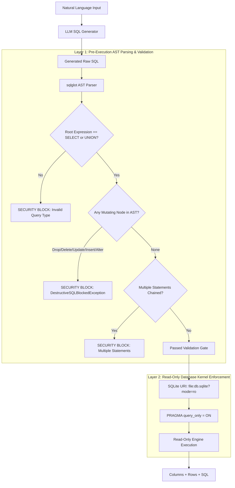

# Role B: SQL Safety & Security Guarantees

## 1. Safety Philosophy & Threat Model
In text-to-SQL systems, relying solely on LLM prompt instructions (e.g. *"Please only generate SELECT queries"*) is completely unacceptable as a security control. Attackers or confused models can be manipulated via prompt injection or unexpected user queries to generate destructive commands:

```sql
-- Examples of forbidden operations
DROP TABLE customers;
DELETE FROM employees WHERE 1=1;
UPDATE orders SET total_amount = 0;
ALTER TABLE departments DROP COLUMN budget;
ATTACH DATABASE '/etc/passwd' AS stolen;
SELECT load_extension('/path/to/malicious.so');
```

The Role B Data Service implements a **multi-layered defense-in-depth architecture** that guarantees no mutating or destructive operation can ever execute.

---

## 2. Multi-Layer Security Architecture



### Layer 1: Abstract Syntax Tree (AST) Validation (`safety/validator.py`)
- **Library**: `sqlglot` industrial SQL parser.
- **Pre-execution gate**: Validation runs *entirely in memory before opening or querying the database*.
- **Forbidden AST Nodes**:
  - `exp.Drop` (e.g. `DROP TABLE`, `DROP INDEX`)
  - `exp.Delete` (`DELETE FROM`)
  - `exp.Update` (`UPDATE ... SET`)
  - `exp.Insert` (`INSERT INTO`)
  - `exp.Create` (`CREATE TABLE`, `CREATE VIEW`)
  - `exp.Alter` (`ALTER TABLE`)
  - `exp.Command` (`ATTACH`, `DETACH`, `PRAGMA`)
  - `exp.TruncateTable` (`TRUNCATE`)
- **Multi-statement rejection**: Any query containing statement chaining (e.g. `SELECT 1; DROP TABLE users;`) is immediately rejected with `MultipleStatementsBlockedException`.
- **Dangerous function blocking**: Rejects dangerous engine functions like `load_extension`.

### Layer 2: Read-Only Database Connection (`db/connection.py`)
Even in the theoretical event that a query bypassed the AST validator, the database layer physically rejects write attempts:
1. **URI Read-Only Mode**: Opened using `file:{path}?mode=ro` (enforced by OS file system driver).
2. **SQLite Query-Only Pragma**: `PRAGMA query_only = ON;` blocks any transaction attempting page modifications.
3. If any mutation is attempted, SQLite raises `sqlite3.OperationalError: attempt to write a readonly database`.

### Layer 3: Bounded Resource Limits
- **Execution Timeout**: 5.0-second query deadline prevents runaway Cartesian joins (`SELECT * FROM orders, order_items, customers`).
- **Result Truncation**: Returned datasets are capped at `limit` (default: 100 rows, max: 1,000) to protect memory and network bandwidth.

---

## 3. Proof of Enforcement (Validation vs Execution)
In accordance with **Acceptance Criterion 3**:
> *"Destructive SQL provably blocked at validation, not at execution (Ask it to drop a table and check where the block happens)"*

When a user or model supplies:
```sql
DROP TABLE customers;
```
The stack trace verifies that execution never takes place:
```
safety.errors.DestructiveSQLBlockedException: SECURITY BLOCK [Validation Phase]: Destructive operation 'DROP' is strictly prohibited. Query execution aborted before touching the database.
```
No database connection is opened, no write lock is requested, and the table remains untouched.
