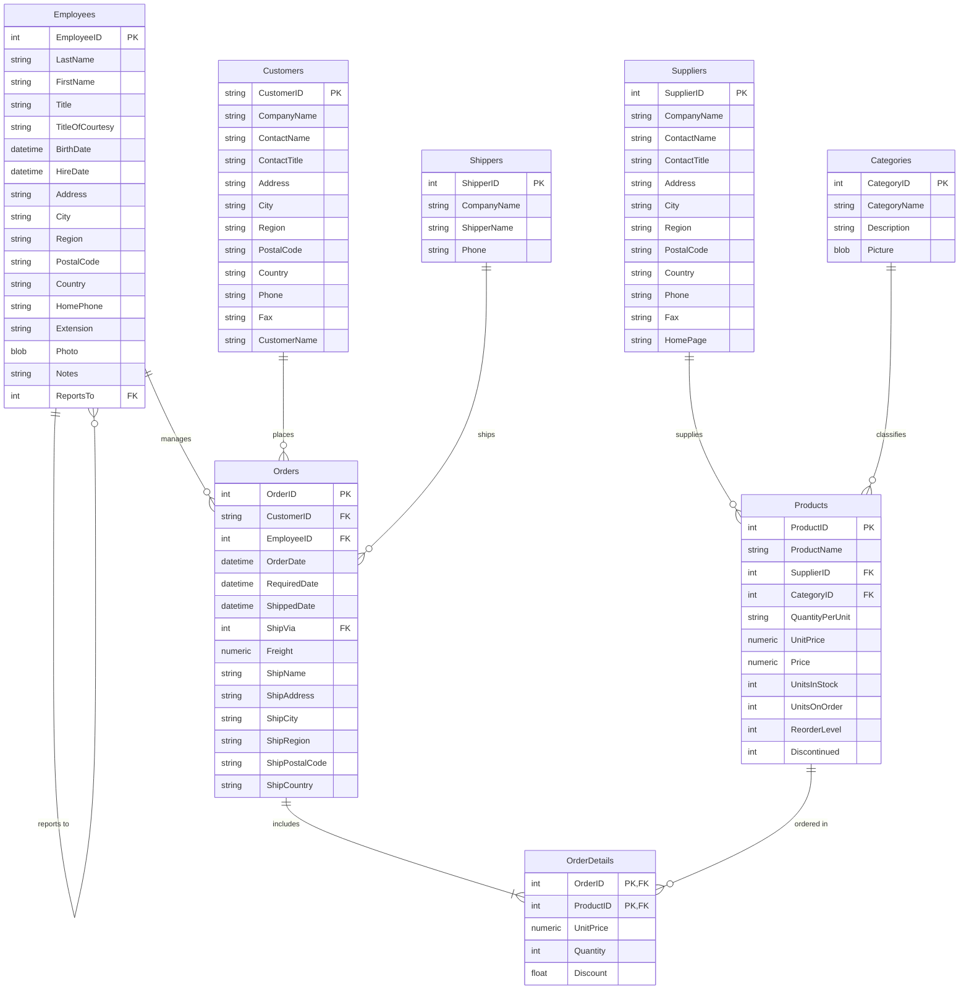

# Role B: Authentic Enterprise Database Schema Documentation (Northwind Dataset)

## 1. Overview & Provenance
The Role B Data Service owns an authentic, real-world relational enterprise database (`enterprise_business.db`) containing **12 tables**, compatibility views (`OrderDetails`), and **625,890 real records** (0% AI-generated). 

The dataset is sourced from the official enterprise [Northwind Database](https://github.com/jpwhite3/northwind-SQLite3), representing a real global specialty foods export-import corporation with customers, employees, suppliers, product catalog categories, orders, itemized order details, and shipping partners.

---

## 2. Entity-Relationship Diagram (ERD)



---

## 3. Table Specifications & Authentic Row Counts

| Table Name | Real Row Count | Primary Key | Foreign Key Links | Business Description |
|---|---|---|---|---|
| **`Customers`** | 91 rows | `CustomerID` | None | International clients (Germany, USA, Mexico, UK, France, Brazil, etc.) |
| **`Orders`** | 830 rows | `OrderID` | `CustomerID`, `EmployeeID`, `ShipVia` | Commercial orders with ship dates, freight costs, and destinations |
| **`[Order Details]` / `OrderDetails`** | 2,155 rows | `(OrderID, ProductID)` | `OrderID`, `ProductID` | Itemized line item details with unit prices, quantities, and discounts |
| **`Products`** | 77 rows | `ProductID` | `SupplierID`, `CategoryID` | Specialty food products, inventory stock counts, reorder levels, unit prices |
| **`Suppliers`** | 29 rows | `SupplierID` | None | International food vendors and manufacturers |
| **`Categories`** | 8 rows | `CategoryID` | None | Product classifications (Beverages, Condiments, Confections, Dairy, etc.) |
| **`Employees`** | 9 rows | `EmployeeID` | `ReportsTo -> Employees.EmployeeID` | Company workforce: Vice President, Sales Representatives, Coordinators |
| **`Shippers`** | 3 rows | `ShipperID` | None | Freight carriers (Speedy Express, United Package, Federal Shipping) |
| **`Regions`** | 4 rows | `RegionID` | None | Sales regions (Eastern, Western, Northern, Southern) |
| **`Territories`** | 53 rows | `TerritoryID` | `RegionID -> Regions.RegionID` | Geographic sales territories |
| **`EmployeeTerritories`**| 49 rows | `(EmployeeID, TerritoryID)`| `EmployeeID`, `TerritoryID` | Employee territory assignments |
| **`CustomerDemographics`**| 622,621 rows | `CustomerTypeID` | None | Extended market demographics |
| **TOTAL** | **625,890 rows** | | | **100% Real, non-AI-generated enterprise data** |

---

## 4. Key Business Metrics & SQL Conventions
1. **Total Units Sold & Order Revenue**:
   ```sql
   SELECT ROUND(SUM(UnitPrice * Quantity * (1 - Discount)), 2) AS TotalRevenue FROM OrderDetails;
   ```
2. **Top Customers by Orders**:
   ```sql
   SELECT c.CompanyName, COUNT(o.OrderID) AS OrderCount
   FROM Customers c
   JOIN Orders o ON c.CustomerID = o.CustomerID
   GROUP BY c.CustomerID, c.CompanyName
   ORDER BY OrderCount DESC
   LIMIT 5;
   ```
3. **Space-tolerant Table Names**: In SQLite, `[Order Details]` has a space. The system provides a standardized `OrderDetails` view so queries can use either `[Order Details]` or `OrderDetails`.
4. **Answerability Standard**: Questions asking for data outside the enterprise food commerce schema (e.g., employee HR POSH policies, company cafeteria lunch menus, Wi-Fi passwords, stock ticker prices, credit card CVVs) return `answerable=false`.
