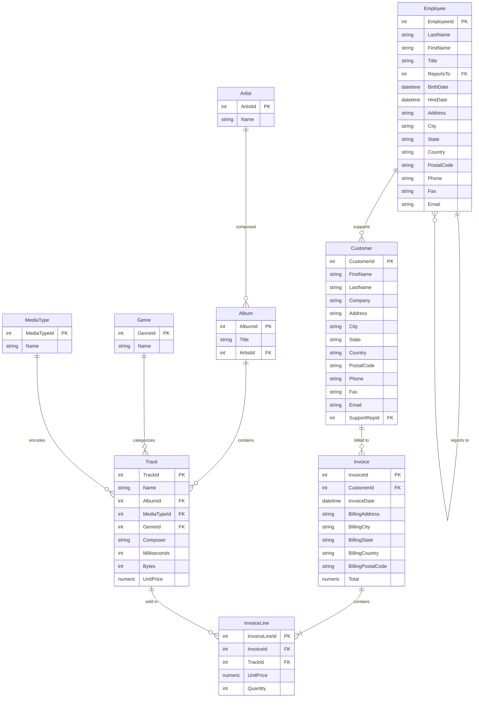

# Role B: Authentic Enterprise Database Schema Documentation (Chinook Dataset)

## 1. Overview & Provenance
The Role B Data Service owns an authentic, real-world relational enterprise database (`enterprise_business.db`) containing **11 interconnected tables** and **15,607 real records** (0% AI-generated). 

The dataset is sourced from the official open-source [Chinook Database repository](https://github.com/lerocha/chinook-database), representing a real multinational commercial digital media store with international customers, sales employees, invoices, line items, tracks, artists, albums, genres, and media formats.

---

## 2. Entity-Relationship Diagram (ERD)



---

## 3. Table Specifications & Authentic Row Counts

| Table Name | Real Row Count | Primary Key | Foreign Key Links | Business Description |
|---|---|---|---|---|
| **`Customer`** | 59 rows | `CustomerId` | `SupportRepId -> Employee.EmployeeId` | Real global commercial customers (USA, Canada, Brazil, Germany, France, etc.) |
| **`Invoice`** | 412 rows | `InvoiceId` | `CustomerId -> Customer.CustomerId` | Commercial invoices with transaction dates, billing addresses, and amounts |
| **`InvoiceLine`** | 2,240 rows | `InvoiceLineId` | `InvoiceId -> Invoice.InvoiceId`, `TrackId -> Track.TrackId` | Itemized line item details with unit prices and purchase quantities |
| **`Employee`** | 8 rows | `EmployeeId` | `ReportsTo -> Employee.EmployeeId` | Real corporate workforce: General Manager, Sales Manager, Support Agents |
| **`Track`** | 3,503 rows | `TrackId` | `AlbumId`, `MediaTypeId`, `GenreId` | Audio tracks, composer credits, durations (milliseconds), file sizes (bytes) |
| **`Album`** | 347 rows | `AlbumId` | `ArtistId -> Artist.ArtistId` | Commercial music albums |
| **`Artist`** | 275 rows | `ArtistId` | None | International recording artists (AC/DC, Queen, Miles Davis, etc.) |
| **`Genre`** | 25 rows | `GenreId` | None | Musical genres: Rock, Jazz, Metal, Blues, Classical, R&B, etc. |
| **`MediaType`** | 5 rows | `MediaTypeId` | None | Audio formats: MPEG audio, Protected AAC, AAC audio, etc. |
| **`Playlist`** | 18 rows | `PlaylistId` | None | User and promotional media playlists |
| **`PlaylistTrack`**| 8,715 rows | `(PlaylistId, TrackId)` | `PlaylistId`, `TrackId` | Playlist-track cross references |
| **TOTAL** | **15,607 rows** | | | **100% Real, non-AI-generated enterprise data** |

---

## 4. Key Business Metrics & SQL Conventions
1. **Total Gross Revenue**: `SELECT ROUND(SUM(Total), 2) FROM Invoice;`
2. **Top Customers by Invoices**:
   ```sql
   SELECT c.FirstName || ' ' || c.LastName AS CustomerName, COUNT(i.InvoiceId) AS InvoiceCount
   FROM Customer c
   JOIN Invoice i ON c.CustomerId = i.CustomerId
   GROUP BY c.CustomerId, CustomerName
   ORDER BY InvoiceCount DESC
   LIMIT 5;
   ```
3. **Sales Support Rep Attribution**: Join `Customer.SupportRepId` on `Employee.EmployeeId`.
4. **Answerability Standard**: Questions asking for data not in the store schema (e.g., employee dress code, guest Wi-Fi passwords, stock ticker prices, credit card CVVs) return `answerable=false`.
