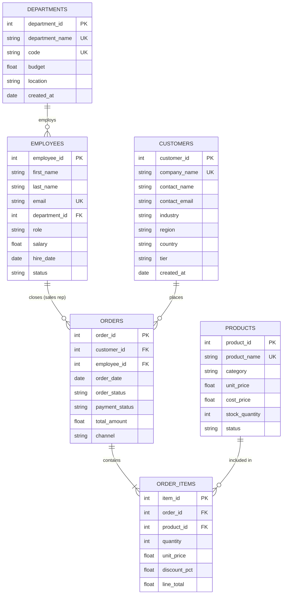

# Role B: Enterprise Business Database Schema Documentation

## 1. Overview & Architecture
The Role B Data Service owns an enterprise relational database (`enterprise_business.db`) containing **6 interconnected tables** and **2,049 records**, seeded reproducibly using [seed_database.py](file:///c:/Users/harsh/OneDrive/Desktop/Agentic-AI/unified_business_assistant/data_service/db/seed_database.py).

The schema represents a modern B2B SaaS and Enterprise Technology provider selling software licenses, cloud services, consulting, support packages, and hardware appliances.

---

## 2. Entity-Relationship Diagram (ERD)

---

## 3. Table Specifications & Columns

### 3.1 `departments` (8 rows)
Tracks organisational units, headquarters/regional offices, and annual operational budgets.
| Column | Type | Constraints | Description |
|---|---|---|---|
| `department_id` | INTEGER | PRIMARY KEY AUTOINCREMENT | Unique department identifier |
| `department_name` | TEXT | NOT NULL, UNIQUE | Full name (e.g., 'Engineering', 'Sales & Business Development') |
| `code` | TEXT | NOT NULL, UNIQUE | Abbreviated code (e.g., 'ENG', 'SALES', 'FIN') |
| `budget` | REAL | NOT NULL | Annual operational budget in USD |
| `location` | TEXT | NOT NULL | Office city/state location |
| `created_at` | TEXT | NOT NULL | Date department was established |

### 3.2 `employees` (76 rows)
Company workforce across all 8 functional departments with compensation and tenure.
| Column | Type | Constraints | Description |
|---|---|---|---|
| `employee_id` | INTEGER | PRIMARY KEY AUTOINCREMENT | Unique employee identifier |
| `first_name` | TEXT | NOT NULL | First name |
| `last_name` | TEXT | NOT NULL | Last name |
| `email` | TEXT | NOT NULL, UNIQUE | Corporate email address |
| `department_id` | INTEGER | NOT NULL, FK -> `departments` | Assigned department |
| `role` | TEXT | NOT NULL | Job title (e.g., 'Enterprise Account Executive') |
| `salary` | REAL | NOT NULL | Annual base salary in USD |
| `hire_date` | TEXT | NOT NULL | Date employee joined company |
| `status` | TEXT | NOT NULL | `Active`, `On Leave`, or `Terminated` |

### 3.3 `customers` (120 rows)
B2B enterprise client accounts across global regions and sectors.
| Column | Type | Constraints | Description |
|---|---|---|---|
| `customer_id` | INTEGER | PRIMARY KEY AUTOINCREMENT | Unique customer identifier |
| `company_name` | TEXT | NOT NULL, UNIQUE | Client business name (e.g., 'Acme Global Industries') |
| `contact_name` | TEXT | NOT NULL | Primary stakeholder contact |
| `contact_email` | TEXT | NOT NULL | Stakeholder email address |
| `industry` | TEXT | NOT NULL | `Technology`, `Healthcare`, `Finance`, `Retail`, `Manufacturing`, `Education` |
| `region` | TEXT | NOT NULL | `North America`, `Europe`, `Asia-Pacific`, `Latin America` |
| `country` | TEXT | NOT NULL | Country of primary headquarters |
| `tier` | TEXT | NOT NULL | Client tier: `Enterprise`, `Mid-Market`, `Startup` |
| `created_at` | TEXT | NOT NULL | Onboarding account creation date |

### 3.4 `products` (40 rows)
Catalogue of software products, cloud subscriptions, hardware units, and professional consulting services.
| Column | Type | Constraints | Description |
|---|---|---|---|
| `product_id` | INTEGER | PRIMARY KEY AUTOINCREMENT | Unique product catalogue identifier |
| `product_name` | TEXT | NOT NULL, UNIQUE | Commercial product name |
| `category` | TEXT | NOT NULL | `Software Licenses`, `Cloud Services`, `Hardware`, `Consulting Services`, `Support Packages` |
| `unit_price` | REAL | NOT NULL | List selling price in USD |
| `cost_price` | REAL | NOT NULL | Cost of goods sold (COGS) in USD |
| `stock_quantity` | INTEGER | NOT NULL | Available inventory units (9999 for digital cloud/software) |
| `status` | TEXT | NOT NULL | `Active` or `Discontinued` |

### 3.5 `orders` (450 rows)
Commercial sales orders placed by customers and closed by account executives.
| Column | Type | Constraints | Description |
|---|---|---|---|
| `order_id` | INTEGER | PRIMARY KEY AUTOINCREMENT | Unique sales order number |
| `customer_id` | INTEGER | NOT NULL, FK -> `customers` | Ordering client |
| `employee_id` | INTEGER | NOT NULL, FK -> `employees` | Closing account executive / sales rep |
| `order_date` | TEXT | NOT NULL | Order transaction date (YYYY-MM-DD) |
| `order_status` | TEXT | NOT NULL | `Completed`, `Processing`, `Cancelled`, `Refunded` |
| `payment_status` | TEXT | NOT NULL | `Paid`, `Pending`, `Failed` |
| `total_amount` | REAL | NOT NULL | Calculated invoice gross total (sum of order item lines) |
| `channel` | TEXT | NOT NULL | `Direct Sales`, `Online Portal`, `Partner Referral` |

### 3.6 `order_items` (1,355 rows)
Line item detail for individual products purchased within each sales order.
| Column | Type | Constraints | Description |
|---|---|---|---|
| `item_id` | INTEGER | PRIMARY KEY AUTOINCREMENT | Unique line item record identifier |
| `order_id` | INTEGER | NOT NULL, FK -> `orders` | Parent sales order |
| `product_id` | INTEGER | NOT NULL, FK -> `products` | Product purchased |
| `quantity` | INTEGER | NOT NULL, CHECK(`quantity > 0`) | Number of units ordered |
| `unit_price` | REAL | NOT NULL | Price charged per unit at transaction time |
| `discount_pct` | REAL | NOT NULL, DEFAULT 0.0 | Promotional or volume discount (0.00 to 0.20) |
| `line_total` | REAL | NOT NULL | Final net price: `quantity * unit_price * (1 - discount_pct)` |

---

## 4. Key Business Definitions & Conventions
1. **Gross Revenue**: `SUM(orders.total_amount) WHERE orders.order_status = 'Completed' AND orders.payment_status = 'Paid'`
2. **Sales Rep Attribution**: Join `orders.employee_id` with `employees.employee_id` (only employees in department_id = 2 'Sales & Business Development').
3. **Active Workforce**: `status = 'Active'` in table `employees`.
4. **Discounts**: Stored as fractional rates (e.g. `0.10` represents 10% discount).
5. **Answerability Standard**: If a question references entities not in this schema (e.g. employee medical leaves, WiFi passwords, CEO home address, stock ticker prices), `answerable` must be returned as `false`.
