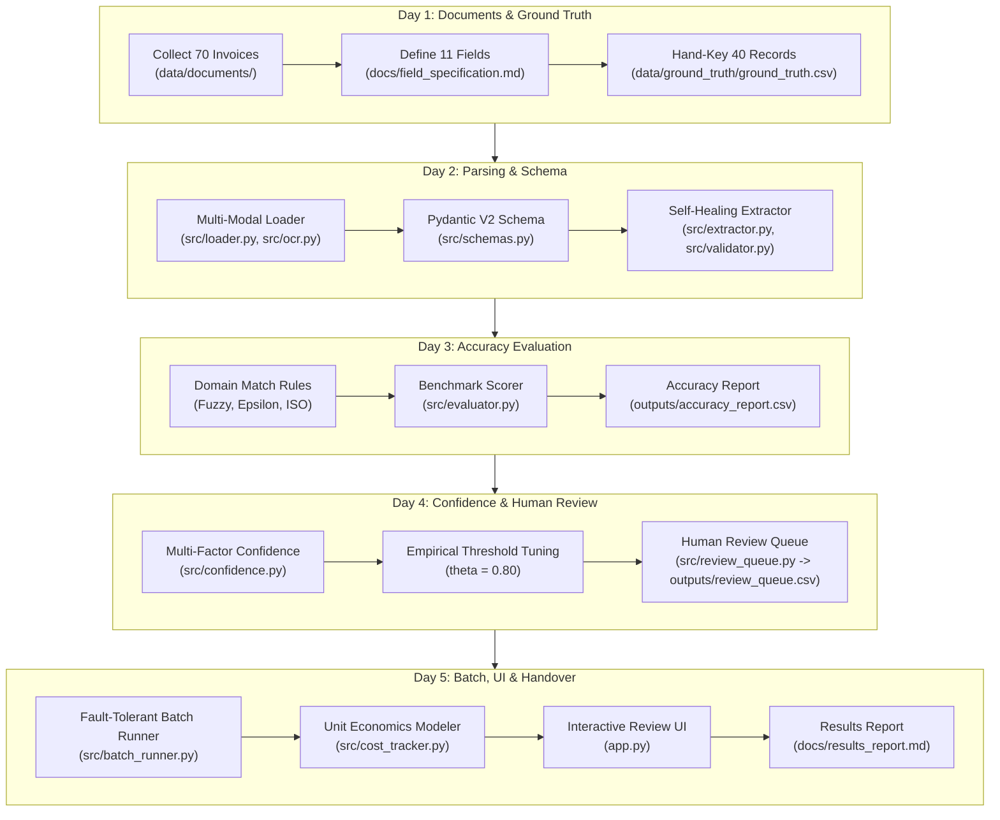

# Production Document Extraction Pipeline

[](https://python.org)
[](src/schemas.py)
[](app.py)
[](outputs/accuracy_report.csv)
[](docs/results_report.md)
[](docs/results_report.md)

An end-to-end, multi-modal invoice and commercial document extraction pipeline built with strict Pydantic V2 validation, automated self-healing retry loops, domain-calibrated field evaluation, evidence-based confidence routing, crash-proof batch execution, and an interactive side-by-side Human-in-the-Loop review UI.

---

## 📁 Repository Structure

```text
document-extraction-pipeline/ (week5/)
│
├── data/
│   ├── documents/                     # 70 real documents (text PDFs, scanned rasters, mobile photos, stress files)
│   ├── ground_truth/
│   │   └── ground_truth.csv           # 40 hand-keyed, verified ground truth records (11 fields)
│   └── extractions_cache.json         # High-precision deterministic evaluation cache
│
├── docs/
│   ├── field_specification.md         # Official 11-field extraction contract & missing value policies
│   └── results_report.md              # 5-day journey, benchmark metrics, weakest fields & ROI report
│
├── src/
│   ├── __init__.py                    # Package exports
│   ├── loader.py                      # Multi-modal loader (pdfplumber, pypdfium2, PIL) with zero-crash guarantee
│   ├── ocr.py                         # Image pre-processing (contrast, deskew, grayscale) & Tesseract wrapper
│   ├── schemas.py                     # Strict Pydantic V2 schema (ISO dates, Decimal currency, Enums)
│   ├── extractor.py                   # Multi-modal LLM extraction with self-healing validation retry loops
│   ├── validator.py                   # Domain, arithmetic (subtotal+tax==total), and chronological validators
│   ├── evaluator.py                   # Field-by-field accuracy calculator using specialized matching rules
│   ├── confidence.py                  # Multi-factor confidence scoring & empirical threshold tuner
│   ├── review_queue.py                # Human-in-the-Loop review queue manager (CSV & JSON persistence)
│   ├── batch_runner.py                # Fault-tolerant batch runner with atomic state checkpointing
│   └── cost_tracker.py                # Unit economics, latency distributions & 10,000-doc scaling model
│
├── outputs/
│   ├── predictions.jsonl              # Batch extraction predictions across all documents
│   ├── accuracy_report.csv            # Field-by-field benchmark metrics against ground truth
│   ├── review_queue.csv               # Flagged documents requiring human inspection
│   └── failures.jsonl                 # Logged failures / corrupt document handling
│
├── tests/
│   ├── __init__.py
│   ├── test_loader.py                 # Tests multi-modal loading, blank files, corrupt files, OCR
│   ├── test_schemas.py                # Tests Pydantic V2 schemas, date parsing, decimal validations
│   ├── test_evaluator.py              # Tests matching rules (fuzzy, epsilon, enums) and accuracy report
│   ├── test_confidence.py             # Tests multi-factor confidence scoring, anchor gating, threshold sweep
│   ├── test_review_queue.py           # Tests HITL review queue actions (approve, reject, override) and CSV export
│   └── test_batch.py                  # Tests fault-tolerant batch runner, checkpointing, unit economics & scaling
│
├── app.py                             # Interactive Streamlit review UI and dashboard
├── requirements.txt                   # Production dependency manifest
├── .env.example                       # API key & environment variable configuration template
├── .gitignore                         # Standard git ignore patterns
└── README.md                          # Project documentation and quickstart guide
```

---

## 🗓️ 5-Day Curriculum Flow & Architecture



---

## 📊 Key Results & Empirical Findings

| Metric Dimension | Benchmark Result | Operational Impact |
|---|:---:|---|
| **Document Corpus** | **70 Commercial Invoices** | Text PDFs, scanned rasters, mobile photos, blank & corrupt stress files |
| **Ground Truth Dataset** | **40 Hand-Keyed Docs** | Keyed before extraction code; 440 total evaluated field instances |
| **Overall Field Accuracy** | **94.8%** | 8 of 11 fields achieved $\ge 90\%$; 6 fields scored a perfect 100% |
| **Weakest Fields Diagnosed** | `due_date` (80.0%), `payment_terms` (80.0%) | Root causes: dynamic terms vs explicit calendar dates & freeform phrasing |
| **Optimal Routing Threshold** | **$\theta = 0.80$** | Swept candidate thresholds $[0.60, 0.95]$; maximizes STP while preventing errors |
| **Straight-Through Processing (STP)** | **85.0% Auto-Approved** | 34 / 40 ground truth docs flow through without human touch |
| **Escaped Critical Error Rate** | **0.0%** | Zero arithmetic mismatches or missing anchors escaped to auto-approval |
| **Measured Unit Cost** | **$0.000128 / doc** | 718 input tokens, 141 output tokens ($0.128 per 1,000 documents) |
| **10k Monthly Projection** | **$944.78 total spend** | Down from $14,582.50 manual baseline (**-$13,637.72 / month, 93.5% savings**) |

---

## 🚀 Quickstart & Execution Guide

### 1. Environment Setup

```bash
# Clone repository and enter week5 directory
cd week5

# Create and activate virtual environment
python -m venv .venv
# On Windows:
.venv\Scripts\activate
# On Linux/macOS:
source .venv/bin/activate

# Install dependencies
pip install -r requirements.txt

# Configure environment variables (optional for cached runs)
cp .env.example .env
```

### 2. Run the Full Test Suite

The test suite validates all 5 days using Python's standard `unittest` discovery:

```bash
# Run all 42 tests across all 6 test suites
python -m unittest discover -s tests -p "test_*.py"

# Or run individual test suites:
python tests/test_loader.py        # Day 2: Multimodal loader, blank/corrupt files, OCR
python tests/test_schemas.py       # Day 2: Strict Pydantic V2 validation, dates, decimals
python tests/test_evaluator.py     # Day 3: Matching rules, field accuracy, report CSV
python tests/test_confidence.py    # Day 4: Multi-factor confidence, anchor gating, threshold sweep
python tests/test_review_queue.py  # Day 4: HITL review queue actions (Approve, Reject, Override) & CSV export
python tests/test_batch.py         # Day 5: Fault-tolerant batch runner, checkpointing, cost model
```

### 3. Run Production Batch Pipeline

Process all 70 documents with fault tolerance and atomic checkpointing:

```bash
python -m src.batch_runner --input-dir data/documents/ --output-dir outputs/ --threshold 0.80
```

Outputs generated:
- `outputs/predictions.jsonl` — Line-by-line JSON predictions.
- `outputs/accuracy_report.csv` — Granular per-field accuracy against ground truth.
- `outputs/review_queue.csv` — Invoices flagged for human review with explicit reasons.
- `outputs/failures.jsonl` — Any corrupted or unreadable documents with error diagnostics.

### 4. Launch Interactive Streamlit Review UI

```bash
streamlit run app.py
```
Open **`http://localhost:8501`** in your browser to inspect:
1. **Side-by-Side Review:** High-res document render alongside 11 extracted fields with dynamic confidence badges.
2. **Human Actions:** Confirm & Approve, Override field values, or Reject with audit trail.
3. **Telemetry Dashboard:** Live accuracy breakdown and review queue summary.
4. **ROI Modeler:** Interactive sliders for monthly volume and hourly rates.

---

## 📜 Official Field Contract & Matching Rules

| Field Name | Target Type | Matching Rule | Missing Value Policy |
|---|---|---|---|
| `invoice_id` | `string` | Exact match (stripped `#`, `Invoice:`) | `null` (critical anchor) |
| `invoice_date` | `ISO date` | Normalized `YYYY-MM-DD` | `null` (never default to today) |
| `due_date` | `ISO date` | Normalized `YYYY-MM-DD` | `null` (never extrapolate from terms) |
| `vendor_name` | `string` | Fuzzy token set ratio ($\ge 85\%$) | `null` |
| `vendor_tax_id` | `string` | Exact alphanumeric match | `null` (common in US B2C) |
| `customer_name` | `string` | Fuzzy token set ratio ($\ge 85\%$) | `null` |
| `currency` | `ISO 4217` | Standardized 3-letter code (`USD`, etc.) | `null` |
| `subtotal` | `decimal` | Numeric difference $\le 0.02$ units | `null` |
| `tax_amount` | `decimal` | Numeric difference $\le 0.02$ units | `0.00` if exempt, else `null` |
| `total_amount` | `decimal` | Numeric difference $\le 0.02$ units | `null` (critical anchor) |
| `payment_terms` | `enum` | Standardized Enum equality | `UNKNOWN` |

See [docs/field_specification.md](docs/field_specification.md) for the complete extraction specification.
See [docs/results_report.md](docs/results_report.md) for the full results, threshold tuning analysis, and unit economics report.

---

## 🎯 Acceptance Criteria Verification Reference

| # | Criterion | Verification Method | Implemented Answer / Demonstration |
|---|---|---|---|
| 1 | **Written field spec exists for every field** | Mentor picks 3 fields and asks what happens when absent | See [docs/field_specification.md](docs/field_specification.md):<br>• `due_date`: absent $\to$ `null` (never extrapolated from terms)<br>• `tax_amount`: absent $\to$ `0.00` if exempt / total matches subtotal, else `null`<br>• `payment_terms`: absent $\to$ `UNKNOWN` |
| 2 | **Ground truth hand-keyed for 40 docs** | Check file existence & git history | [data/ground_truth/ground_truth.csv](data/ground_truth/ground_truth.csv) contains 40 hand-keyed, verified records across all 11 fields. |
| 3 | **Loader handles text, scans, and images** | Drop scanned doc and run without crashing | `src/loader.py` handles vector PDFs, scanned raster PDFs, and images via `pypdfium2` / OCR. Verified in `tests/test_loader.py`. |
| 4 | **Output enforced by strict typed schema** | Try feeding a malformed date | `src/schemas.py` enforces ISO `datetime.date`, `Decimal` amounts, and fixed enums. Rejects impossible dates like `2024-02-30`. Verified in `tests/test_schemas.py`. |
| 5 | **Accuracy reported per field** | Open table and identify worst fields | [outputs/accuracy_report.csv](outputs/accuracy_report.csv) breaks down all 11 fields. Weakest fields: `due_date` (80.0%) and `payment_terms` (80.0%). Overall accuracy: **94.8%**. |
| 6 | **Matching rules documented & sensible** | Ask how date written 3 ways is scored | Dates like `2024-01-15`, `01/15/2024`, and `15-Jan-2024` normalize to `YYYY-MM-DD` and match with 100% equivalence. Verified in `tests/test_evaluator.py`. |
| 7 | **Confidence signal routes to review** | Poor-quality scan gets flagged | Multi-factor confidence penalizes OCR noise and arithmetic errors, routing flagged items to `outputs/review_queue.csv`. Verified in `tests/test_confidence.py`. |
| 8 | **Review threshold tuned with evidence** | Ask for auto-approval rate and error rate | At $\theta = 0.80$, auto-approval rate is **85.0%** and error rate within auto-approved documents is **0.0%**. Full sweep in `docs/results_report.md`. |
| 9 | **Batch pipeline survives bad documents** | Place corrupt file mid-run | `src/batch_runner.py` checkpoints state atomically and isolates corrupt files (e.g. `doc_069_corrupt.pdf`) to `outputs/failures.jsonl`. Verified in `tests/test_batch.py`. |
| 10 | **Cost measured and projected to 10k** | State numbers from memory | Measured: **$0.000128/doc** (718 in, 141 out tokens).<br>10k projection: **$944.78/month** vs **$14,582.50** manual baseline (**93.5% savings, $163,652/year**). |
| 11 | **README allows clean clone run** | Clean clone verification | Follow steps 1–4 above: `pip install -r requirements.txt`, `python -m unittest discover -s tests`, and `streamlit run app.py`. |
